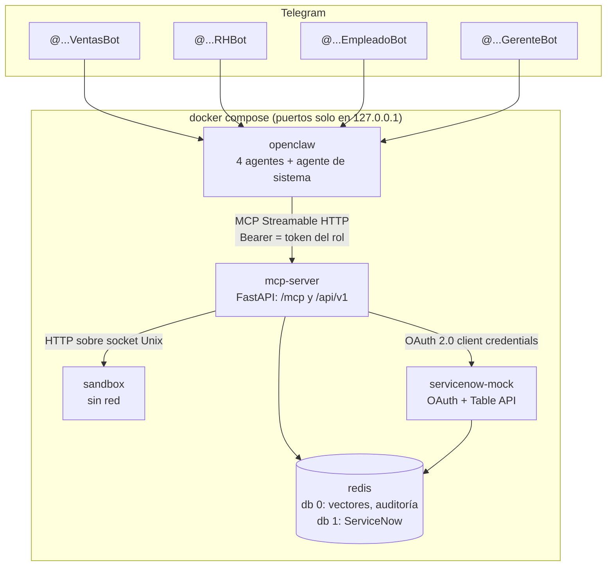
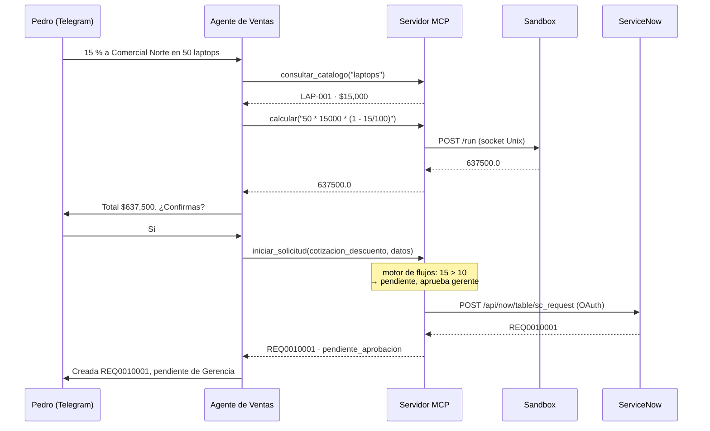
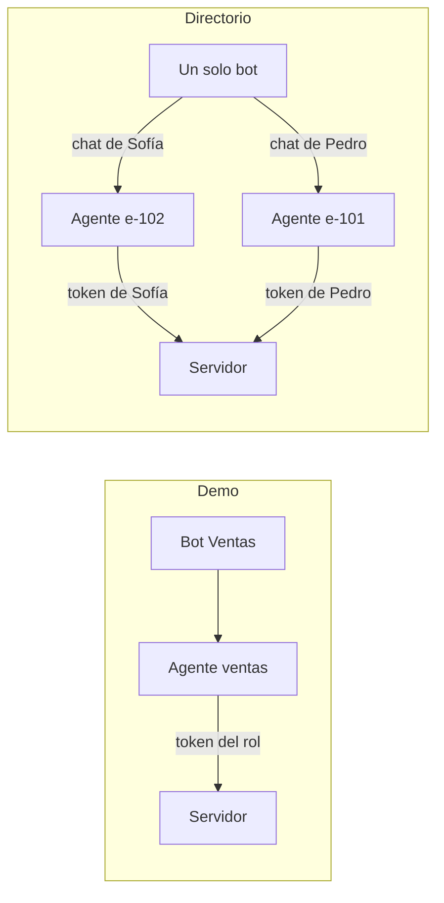

# Arquitectura

## Componentes



| Servicio | Qué hace | Expuesto |
|---|---|---|
| `openclaw` | Gateway de agentes: un agente por rol, un bot por agente | `127.0.0.1:18790` |
| `mcp-server` | Autenticación, permisos, RAG, motor de flujos, solicitudes y auditoría | `127.0.0.1:8000` |
| `sandbox` | Ejecuta el código de `calcular` con límites | No (sin red) |
| `servicenow-mock` | Subconjunto compatible de la API de ServiceNow | No |
| `redis` | Índice vectorial, bitácora y datos del ServiceNow simulado | No |

## Capas del servidor

```
REST (/api/v1)   ─┐
                  ├─▶  tools/  ── @tool: permiso + auditoría ──▶  servicios
MCP (/mcp)       ─┘
```

- **Transporte** (`rest.py`, `mcp_app.py`): autentica y traduce errores. No tiene lógica.
- **Herramientas** (`tools/`): una función por herramienta, decorada con `@tool`. El
  decorador valida el permiso y registra la auditoría, así ninguna lo olvida.
- **Servicios**: `rag/` (búsqueda), `flows/` (catálogo y motor de reglas),
  `requests_service.py` (solicitudes), `catalog.py`, `sandbox_client.py` y
  `servicenow_client.py`.
- **Configuración**: `company/` carga y valida `empresa/` con Pydantic al arrancar.

## Una petición, de punta a punta (escena 1)



## RAG filtrado por rol

1. **Ingesta** (al arrancar, si el contenido, los roles o el modelo cambiaron): cada documento
   se parte por encabezados en fragmentos de máximo 600 caracteres y se convierte en vector
   con `paraphrase-multilingual-MiniLM-L12-v2` (fastembed, local).
2. **Índice en Redis**: un hash por fragmento y un set de ids por rol (`rag:role:ventas`).
3. **Búsqueda**: se cargan **solo** los ids del rol y después se ordenan por similitud coseno
   con numpy. Con un corpus pequeño esto tarda microsegundos; con miles de documentos
   convendría Azure AI Search o el módulo vectorial de Redis.

## Datos en Redis

| Clave | Contenido |
|---|---|
| `rag:chunk:<id>`, `rag:role:<rol>`, `rag:meta` | Índice de documentos (db 0) |
| `audit:events` | Bitácora de auditoría, Redis Stream (db 0) |
| `sn:token:<hash>` | Tokens OAuth del ServiceNow simulado, con TTL (db 1) |
| `sn:sc_request:*` | Solicitudes del ServiceNow simulado (db 1) |

## Lo que el servidor decide sin el modelo

| Qué | Dónde | De dónde sale |
|---|---|---|
| Quién llama y qué rol tiene | `auth.py` | El token: por rol (demo) o por persona (directorio) |
| Qué herramientas existen para esa persona | `permissions.py` | `roles.yaml` |
| Qué documentos entran a la búsqueda | `rag/` | Encabezado `roles` de cada documento |
| Precio, total, días hábiles y saldo | `flows/calculations.py` | Catálogo, calendario, empleados y solicitudes previas |
| Estado de la solicitud y quién aprueba | `flows/engine.py` | Reglas del flujo |
| A quién se le avisa | `notifications.py` | Rol que aprueba y solicitante |

## Los dos modos



`openclaw/openclaw.json5` (demo) y `openclaw/local/` (directorio) se **generan** desde
`empresa/` con `assistant.admin`; `start.sh` elige cuál copiar según `AUTH_MODE`.

## Herramientas de la plantilla

| Comando | Qué hace | Código |
|---|---|---|
| `make validate` | Revisa `empresa/` y que agentes, variables y config estén al día | `admin/validation.py` |
| `make new-role` | Crea un rol en todos los archivos (sobre una copia; solo escribe si valida) | `admin/scaffold.py` |
| `make openclaw-config` / `make directorio` | Genera la config de OpenClaw | `admin/openclaw_config.py` |
| `make eval` | Conversa con los agentes y juzga por los hechos del servidor | `scripts/run_evals.py` |
